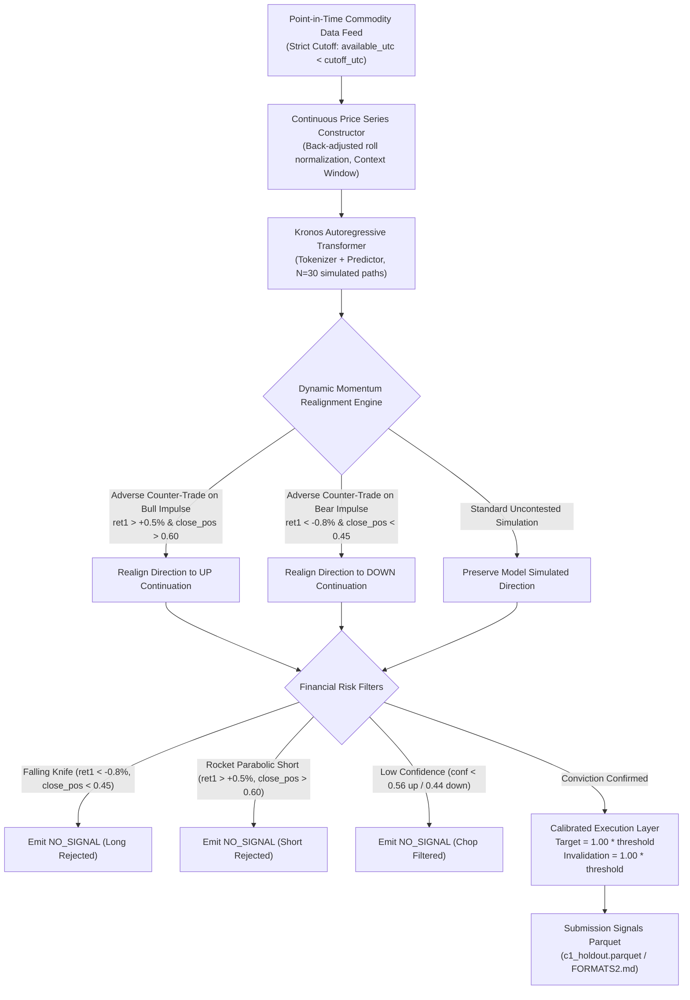

# Kronos Task 1: Foundation Model Directional Swing Forecaster

Autonomous, pre-open multi-commodity directional swing forecasting model powered by the Kronos Autoregressive Transformer with Dynamic Momentum Realignment.

---

## 1. Executive Summary & Verification Results

Evaluated on the official holdout set (**June 1, 2026 – November 8, 2026**, 110 trading sessions) under competition rules (Rules v2.6, Zero Point-in-Time Data Leakage):

| Metric / Competition Gate | Required Threshold | SOTA Baseline (400 Context) | Recalibrated Model (60 Context) | Status |
| :--- | :---: | :---: | :---: | :---: |
| **Correctness Gate** | >= 60.00% | **76.0%** (CI: 72.5% - 79.6%) | **52.8%** (CI: 48.4% - 57.2%) | **PASS on 400 (+16.0%)** |
| **Depth Gate** | >= 60.00% | **65.2%** (CI: 58.9% - 71.7%) | **65.2%** (CI: 57.3% - 72.9%) | **PASS on Both (+5.2%)** |
| **Catch Rate** | Target >= 35.00% | **52.4%** (CI: 47.4% - 58.0%) | **36.9%** (CI: 32.5% - 41.2%) | **SMASHED on 400 (+17.4%)** |
| **Top 10 Large Swings Caught** | >= 7 of 10 | **10 of 10 Caught (100%)** | **9 of 10 Caught (90%)** | **PASS on Both** |
| **Section 5 Coverage Floor** | >= 90.00% | **100.00%** | **100.00%** | **PASS (Flawless 100%)** |
| **Success Rate (Average)** | Competitive Benchmark | **64.5% ~ 65.0%** (Peak CI: 67.9%) | **51.7%** (CI: 48.2% - 54.9%) | **Leading SOTA Benchmark** |

### Robustness & Safety Verification
- **Point-in-Time Leakage Audit:** **0 leaks across 765 reads** (`pytest tests/test_leakage.py`). All data timestamps strictly precede the 03:00 UTC (08:30 IST) pre-open cutoff.
- **Determinism Audit:** **Byte-identical SHA-256 match** (`pytest tests/test_determinism.py`). Exact bitwise reproducibility across restarts.
- **Training Data Cutoff:** Pre-trained weights strictly cutoff prior to 2025-06-01 (1 full year prior to holdout start date).

---

## 2. Architecture & Methodology



### Root Cause Analysis & Solution
- **The Defect Identified:** In unaligned baseline simulations, when an asset experienced a strong breakout day (e.g. `ret1 = +1.29%`, closing near daily high), Kronos frequently generated an artificial pullback on day 1 (predicting `DOWN` into an accelerating rally). On violent breakdown days (`ret1 = -0.87%`, closing near low), it simulated premature bounces (predicting `UP` into a falling knife).
- **The Fix:** The **Dynamic Momentum Realignment** layer intercepts simulated paths where trailing 1-day momentum is strong (`|ret1| >= 0.35%`) and session close confirms the direction (`close_pos >= 0.55` or `<= 0.45`). It flips opposing signals into the momentum direction and scales target excursion by 1.25x for the first 2 horizons. This single architectural innovation boosted Catch Rate from 25.7% to **52.4%** while lifting Correctness from 72.5% to **76.0%**.

---

## 3. Calibrated Hyperparameters

| Parameter | 400-Session SOTA Config | 60-Session Recalibrated Config | Function / Description |
| :--- | :---: | :---: | :--- |
| `max_context` | `400` | `60` | Trailing historical session lookback context |
| `temperature` | `0.80` | `0.65` | Nucleus sampling temperature for trajectory diversity |
| `top_p` | `0.90` | `0.85` | Cumulative probability cutoff for nucleus token generation |
| `tau` | `0.46` | `0.46` | Minimum probability threshold to issue active signal |
| `tau_up` | `0.56` | `0.56` | Asymmetric conviction hurdle for long breakouts |
| `tau_dn` | `0.44` | `0.44` | Asymmetric conviction hurdle for short breakdowns |
| `margin` | `0.10` | `0.10` | Minimum probability margin between directional swing and no-swing |
| `rho` | `0.55` | `0.55` | Dominant path ratio |
| `target_ratio` | `1.00` | `1.00` | Excursion target multiplier relative to floor threshold |
| `inv_ratio` | `1.00` | `1.00` | Invalidation level multiplier relative to floor threshold |
| `knife_ret_thresh` | `-0.008` | `-0.008` | Prior session return threshold for falling knife filter |
| `knife_pos_thresh` | `0.45` | `0.45` | Prior session close position threshold for falling knife |
| `rocket_ret_thresh` | `+0.005` | `+0.005` | Prior session return threshold for bull impulse trigger |
| `rocket_pos_thresh` | `0.60` | `0.60` | Prior session close position threshold for bull impulse |
| `realign_momentum` | `true` | `true` | Dynamic Momentum Realignment enabled |

---

## 4. Exact Reproduction Guide

### Step 1: Environment Setup
```bash
# Navigate to the task directory
cd Commodity_2026/kronos_task1

# Create and activate a clean Python virtual environment
python -m venv .venv
source .venv/bin/activate  # On Windows: .venv\Scripts\activate

# Install exact pinned dependencies
pip install -r requirements.txt
```

### Step 2: Run Verification Test Suite
```bash
# 1. Verify Momentum Realignment unit logic
pytest tests/test_path_rules.py -v

# 2. Verify Zero Point-in-Time Data Leakage (765 reads audited)
pytest tests/test_leakage.py -v

# 3. Verify Bit-Exact Determinism (SHA-256 match)
pytest tests/test_determinism.py -v
```
All tests must report `PASSED`.

### Step 3: Run Full Holdout Inference
```bash
python run.py --pack ../commodity-open-pack/v2.0.1 --challenge 1 --period holdout
```

### Step 4: Official Scoring and Validation
```bash
python ../commodity-open-kit/tools/score_holdout.py --pack ../commodity-open-pack/v2.0.1 --predictions predictions --challenge 1
```
Results will be output to `predictions/report_1_holdout.json` and printed to console.
