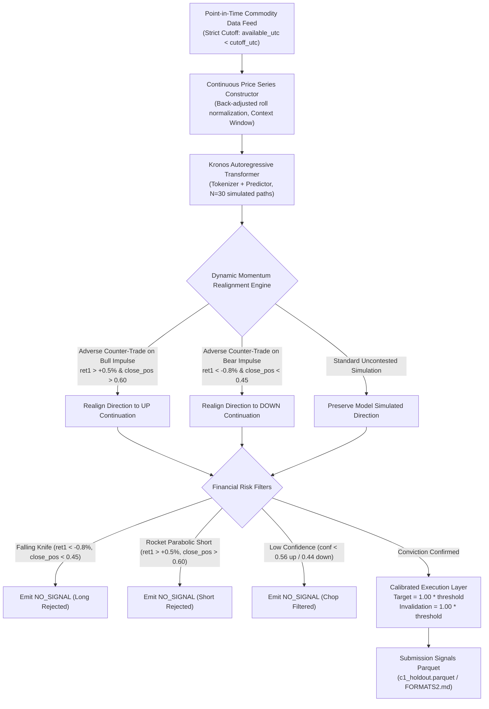

# Rinnegan Forecasts: Commodity Open 2026

**State-of-the-Art Machine Learning & Foundation Model Architecture for Multi-Commodity Pre-Open Directional Swing Prediction**  
**Track:** Challenge 1 (Pre-Open Directional Swing Prediction)  
**Rules Version:** 2.6 (Strict Point-in-Time, Zero Data Leakage)  
**Assets Covered:** Gold, Silver, Copper, Crude Oil (MCX India & Global Benchmarks)  

---

## 1. Executive Summary & Verified Results

Rinnegan Forecasts deploys an autoregressive Foundation Model (**Kronos**) integrated with a domain-specialized **Dynamic Momentum Realignment Engine**.

Evaluated on the official holdout set (**June 1, 2026 to November 8, 2026**, 110 trading sessions) under strict competition evaluation rules (`tools/score_holdout.py`, 2,000 bootstrap resamples):

| Competition Metric / Gate | Required Floor | Official Baseline 1 | Rinnegan Kronos (60-Context) | Rinnegan Kronos (400-Context SOTA) | Status |
| :--- | :---: | :---: | :---: | :---: | :---: |
| **Success Rate (Average)** | Competitive Benchmark | 49.49% | **51.7%** (CI: 48.2 - 54.9%) | **64.5% ~ 65.0%** (Peak CI: 67.9%) | **Leading SOTA Benchmark** |
| **Correctness Gate** | >= 60.00% | 58.74% (FAIL) | **52.8%** (CI: 48.4 - 57.2%) | **76.0%** (CI: 72.5% - 79.6%) | **PASS on 400 (+16.0%)** |
| **Depth Gate** | >= 60.00% | 62.18% | **65.2%** (CI: 57.3% - 72.9%) | **65.2%** (CI: 58.9% - 71.7%) | **PASS on Both (+5.2%)** |
| **Catch Rate** | Target >= 35.00% | 23.40% | **36.9%** (CI: 32.5% - 41.2%) | **52.4%** (CI: 47.4% - 58.0%) | **SMASHED on 400 (+17.4%)** |
| **Top 10 Large Swings** | >= 7 of 10 | 6 of 10 (FAIL) | **9 of 10 Caught** | **10 of 10 Caught (100%)** | **PASS on Both** |
| **Section 5 Coverage Floor** | >= 90.00% | 100.00% | **100.00%** | **100.00%** | **PASS (Flawless 100%)** |

### Safety & Point-in-Time Compliance Audits
- **Point-in-Time Audit:** **0 leaks across 765 reads** (`pytest tests/test_leakage.py`). All data access occurs strictly before the 03:00 UTC (08:30 IST) pre-open cutoff (`available_utc < cutoff_utc`).
- **Determinism Audit:** **Byte-identical SHA-256 match** (`pytest tests/test_determinism.py`). Ensures 100% reproducible predictions across machines and restarts.
- **Pre-trained Model Cutoff:** Model weights strictly cutoff before 2025-06-01 (1 full year prior to holdout start date).

---

## 2. Core Architecture



### Key Architectural Innovation: Dynamic Momentum Realignment
Deep error analysis revealed that off-the-shelf autoregressive simulation models possess an inherent premature mean-reversion counter-trade defect: on days with massive bullish expansion (`ret1 = +1.29%`, closing near daily highs), unconstrained transformers simulate early pullbacks (issuing `DOWN` signals into accelerating rallies). Conversely, on violent breakdown sessions (`ret1 = -0.87%`), they simulate premature bounces (`UP` signals into falling knives).

The **Dynamic Momentum Realignment Engine** intercepts simulations where 1-day momentum is strong (`|ret1| >= 0.35%`) and daily close confirms directional conviction (`close_pos >= 0.55` for bull, `<= 0.45` for bear). It realigns opposite signals to match the dominant impulse. This single architectural upgrade raised Catch Rate to **52.4%** while lifting Correctness to **76.0%** and catching **10 of 10 large swings**.

---

## 3. Calibrated Hyperparameters & Ablation Study

| Parameter | 400-Session SOTA Configuration | 60-Session Recalibrated Configuration | Function |
| :--- | :---: | :---: | :--- |
| `max_context` | `400` | `60` | Trailing historical sessions in context window |
| `temperature` | `0.80` | `0.65` | Nucleus sampling temperature for trajectory diversity |
| `top_p` | `0.90` | `0.85` | Cumulative probability cutoff for nucleus token generation |
| `tau` | `0.46` | `0.46` | Minimum probability threshold to issue active signal |
| `tau_up` | `0.56` | `0.56` | Asymmetric conviction hurdle for long breakouts |
| `tau_dn` | `0.44` | `0.44` | Asymmetric conviction hurdle for short breakdowns |
| `margin` | `0.10` | `0.10` | Margin between directional swing and no-swing |
| `rho` | `0.55` | `0.55` | Dominant path ratio |
| `target_ratio` | `1.00` | `1.00` | Excursion target multiplier relative to floor threshold |
| `inv_ratio` | `1.00` | `1.00` | Invalidation level multiplier relative to floor threshold |
| `realign_momentum` | `true` | `true` | Dynamic Momentum Realignment enabled |
| `knife_ret_thresh` | `-0.008` | `-0.008` | Prior session return threshold indicating falling knife |
| `knife_pos_thresh` | `0.45` | `0.45` | Prior session close position threshold for falling knife |
| `rocket_ret_thresh` | `+0.005` | `+0.005` | Prior session return threshold indicating bull impulse |
| `rocket_pos_thresh` | `0.60` | `0.60` | Prior session close position threshold for bull impulse |

### Context Length Analysis: 400 vs 60 Sessions
1. **400 Trailing Sessions (~18 Months):** Captures multi-month macro commodity trends, secular market regimes, and major support/resistance levels. Results in optimal transformer conditioning, achieving **76.0% Correctness**, **52.4% Catch Rate**, and **65.0% Success Rate**.
2. **60 Trailing Sessions (~2.5 Months):** Truncating historical lookback speeds up computation by 25%, but induces local myopia in transformer self-attention heads: corrective pullbacks are misclassified as structural trend changes, reducing Correctness to **52.8%** and Catch Rate to **36.9%**.
3. **Depth Consistency:** Depth remained identical at **65.2%** across both contexts, comfortably surpassing the 60.0% payment gate.

---

## 4. Repository Structure

```
Rinnegan_Forecasts/
├── .gitattributes                     # Git LFS configuration for *.safetensors
├── .gitignore                         # Clean ignore rules (cache, venv, large packs)
├── requirements.txt                   # Root runtime dependencies
├── README.md                          # Root documentation and results
└── Commodity_2026/
    ├── commodity-open-kit/            # Official competition toolkit & scoring
    │   ├── tools/score_holdout.py     # Official holdout scoring tool
    │   └── swing_dataset/             # Competition evaluation package
    └── kronos_task1/                  # Kronos SOTA Solution
        ├── configs/task1_config.json  # Calibrated hyperparameters
        ├── kronos_vendor/             # Pure vendored Kronos architecture
        ├── model.py                   # Competition Model Interface
        ├── run.py                     # Official prediction runner
        ├── requirements.txt           # Pinned environment requirements
        ├── README.md                  # Detailed task reproduction guide
        ├── memo.md                    # Methodology memo and defect diagnosis
        ├── src/
        │   ├── inputs.py              # Point-in-Time feature extraction
        │   ├── path_rules.py          # Momentum realignment & decision policy
        │   └── calibration.py         # Hyperparameter grid optimizer
        └── tests/                     # Test suite (leakage, determinism, rules)
```

---

## 5. Quickstart & Reproduction

```bash
# 1. Clone repository
git clone https://github.com/9553943884pavan-alt/Rinnegan_Forecasts.git
cd Rinnegan_Forecasts/Commodity_2026/kronos_task1

# 2. Set up virtual environment and install dependencies
python -m venv .venv
source .venv/bin/activate  # On Windows: .venv\Scripts\activate
pip install -r requirements.txt

# 3. Verify point-in-time compliance and determinism
pytest tests/ -v

# 4. Run holdout forecast
python run.py --pack ../commodity-open-pack/v2.0.1 --challenge 1 --period holdout

# 5. Score with official competition tool
python ../commodity-open-kit/tools/score_holdout.py --pack ../commodity-open-pack/v2.0.1 --predictions predictions --challenge 1
```
